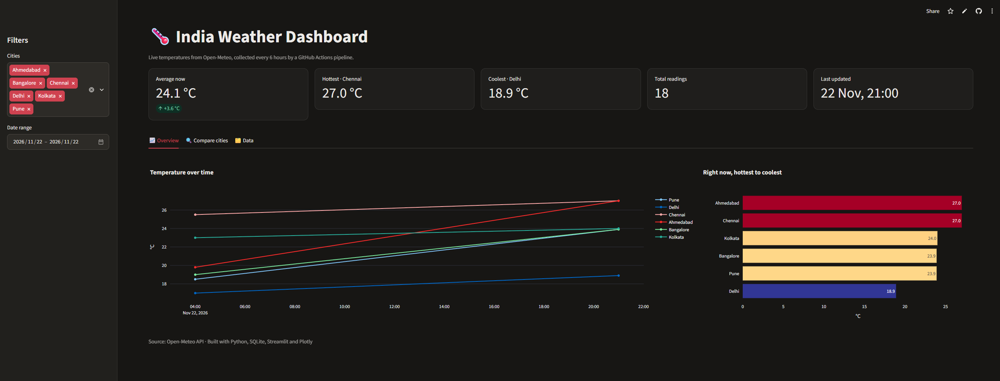

# Weather ETL Pipeline + Live Dashboard



**Live app:** https://india-weather-dashboard-etl.streamlit.app/

A beginner-friendly data engineering project that collects live temperatures for six Indian cities (Pune, Bangalore, Kolkata, Ahmedabad, Chennai, Delhi) every 6 hours, checks the data quality, stores it, and shows it on an interactive dashboard. Built entirely with free tools.

## Architecture

`Open-Meteo API → Python/pandas → validate → SQLite → GitHub Actions (every 6h) → Streamlit dashboard`

## Dashboard

- **5 KPIs:** average temperature now (with change since the last run), hottest city, coolest city, total readings, last updated
- **Filters:** pick cities and a date range
- **Overview:** temperature over time per city, and a ranked "right now" bar chart
- **Compare cities:** average per city, temperature spread (box plot), hour-of-day heatmap
- **Data:** raw table with CSV download

<!-- Screenshots to add later (upload the images to the repo, then remove these comment tags):


-->

## Data quality checks

Before saving, `validate()` stops the run if any check fails, so bad data is never stored:

- exactly 6 rows (one per city)
- no missing values
- no duplicate cities
- temperature between -10 and 55 °C
- timestamp not older than 2 hours (IST)

Rows already saved (same city and timestamp) are skipped.

## How to run

```
pip install -r requirements.txt
python weather_pipeline.py      # fetch, validate, save to weather.db, make avg_temp.png
streamlit run dashboard.py      # open the dashboard
```

`weather.db` is a binary SQLite file, so don't open it in a text editor. Query it instead:

```python
import sqlite3, pandas as pd
print(pd.read_sql("SELECT * FROM weather", sqlite3.connect("weather.db")))
```

## Files

- `weather_pipeline.py` - fetch, validate, save, chart
- `dashboard.py` - Streamlit dashboard
- `requirements.txt` - Python dependencies
- `.github/workflows/weather.yml` - runs the pipeline every 6 hours and commits `weather.db`

## What I learned

- Building an ETL pipeline: extract from an API, transform with pandas, load into SQLite
- Why data validation matters before storing anything
- Automating a job with GitHub Actions and cron schedules
- Debugging real errors: a corrupted `.db` file, YAML indentation, and failing workflow runs
- Turning raw data into KPIs and interactive charts, then deploying for free
- Writing short, clear prompts and checking AI-generated code before trusting it
- Handling flaky APIs with retries and backoff

## Tools

Python, pandas, SQLite, Plotly, Streamlit, GitHub Actions, Open-Meteo API. All free.
